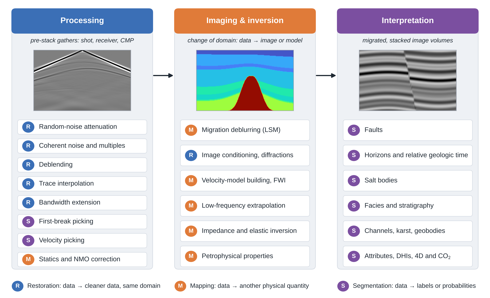

# The U-Net in seismic reflection exploration: a tutorial review of its architectural evolution from processing to interpretation

Figures, code and literature corpus supporting the article by **Matin Mahzad**, Institute of Geophysics, University of Tehran.

**Paper:** [TODO: journal link or DOI]

<p align="center">
  <a href="Figures/Figure_1.pdf"></a>
</p>
<p align="center"><em>Figure 1. The seismic reflection workflow and the three operator roles that U-Nets play in it.</em></p>

## Overview

The review follows the U-Net through the reflection-seismic workflow, from noise attenuation, interpolation and picking, through migration and inversion, to the interpretation of faults, horizons, salt, facies and geobodies. It poses these tasks as three kinds of learned operator (restoration, mapping and segmentation), derives the U-Net from first principles, follows the architecture through six generations as each reached seismic data, and quantifies that evolution with a text-mined corpus of 754 records published between 2018 and 2026.

This is the repository referred to in the manuscript’s Data availability statement. It contains:

- **Figures:** the ten manuscript figures, as 600 dpi PNG and vector PDF.
- **Code:** the scripts that draw every figure, including the finite-difference, eikonal and convolutional-model code behind the synthetic examples, and the scripts that screen and classify the corpus.
- **Data:** the 754 screened records with their task and architecture labels.

This is a review repository: it holds the material behind the figures and the corpus statistics, not trained networks or training code.

**Keywords:** U-Net; deep learning; seismic processing; seismic inversion; seismic interpretation; attention; Transformer; review

## Repository layout

```text
.
├── Figures/
│   ├── Figure_1.png            600 dpi raster
│   ├── Figure_1.pdf            vector
│   ├── ...                     Figures 2 to 9 in the same two formats
│   ├── Figure_10.png
│   └── Figure_10.pdf
├── Code/
│   ├── physics.py              2-D acoustic finite-difference modelling, eikonal first arrivals, convolutional model
│   ├── common.py               plotting style and helpers
│   ├── load.py                 corpus loading and screening (reads the OpenAlex harvest CSV)
│   ├── classify.py             keyword classification into tasks and architectural families
│   ├── fig01.py                Figure 1
│   ├── fig02_10.py             Figures 2 and 10
│   ├── fig03_05.py             Figures 3 and 5
│   ├── fig04.py                Figure 4
│   ├── fig06.py                Figure 6
│   ├── fig07.py                Figure 7
│   ├── fig08.py                Figure 8
│   └── fig09.py                Figure 9
└── Data/
    └── corpus_754_records.csv  the 754 screened records with task and architecture labels
```

## Figures

Figures are numbered as in the manuscript. Each is provided as `Figures/Figure_N.png` (600 dpi) and `Figures/Figure_N.pdf` (vector); the figure number below links to the PNG.

| Figure | Section | Content | Script |
|---|---|---|---|
| [1](Figures/Figure_1.png) | 1 | Seismic reflection workflow and the three operator roles: restoration, mapping, segmentation | `fig01.py` |
| [2](Figures/Figure_2.png) | 2 | Text-mined corpus: records per year, and share of records mentioning each architectural or training component | `fig02_10.py` |
| [3](Figures/Figure_3.png) | 3.2 | Seismic tasks posed as input–target pairs for a U-Net, computed from synthetic data | `fig03_05.py` |
| [4](Figures/Figure_4.png) | 4 | Anatomy of a four-level 2D U-Net | `fig04.py` |
| [5](Figures/Figure_5.png) | 4.4 | Why skip connections matter, shown on a synthetic faulted section | `fig03_05.py` |
| [6](Figures/Figure_6.png) | 5 | Timeline of U-Net architectural generations | `fig06.py` |
| [7](Figures/Figure_7.png) | 5 | Building blocks of the U-Net generations | `fig07.py` |
| [8](Figures/Figure_8.png) | 5.6 | Where attention enters the U-Net, and the memory cost of attention matrices | `fig08.py` |
| [9](Figures/Figure_9.png) | 5.7 | Five ways of training a seismic U-Net | `fig09.py` |
| [10](Figures/Figure_10.png) | 6 | Co-occurrence of tasks and architectural families in the corpus | `fig02_10.py` |

**File names.** The scripts write files under working names that do not always follow the manuscript numbering; for example, `Fig02_task_pairs` is Figure 3. The files in `Figures/` have been renamed to manuscript order, and the table above is keyed to manuscript numbers, so use it to find the script behind any figure.

## Reproducing the figures

**Requirements.** Python 3 with NumPy, SciPy, Matplotlib and pandas (TODO: confirm this list and add tested versions).

Clone or download the repository, then run the scripts from the `Code/` directory:

```bash
cd Code
python fig01.py        # Figure 1
python fig02_10.py     # Figures 2 and 10
python fig03_05.py     # Figures 3 and 5
python fig04.py        # Figure 4
python fig06.py        # Figure 6
python fig07.py        # Figure 7
python fig08.py        # Figure 8
python fig09.py        # Figure 9
```

The figure scripts share `common.py` (plotting style and helpers) and, where they need synthetic data, `physics.py`. Figures 2 and 10 are computed from the screened corpus described below. The scripts write working file names (see *File names* above), not the manuscript-order names used in `Figures/`.

## Corpus

`Data/corpus_754_records.csv` holds the 754 bibliographic records behind the corpus statistics in the review (Section 2 of the manuscript): seismic studies published between 2018 and 2026 whose title or abstract names a U-Net-family network. Each record carries the task and architectural-family labels assigned by keyword matching, and a record can carry several labels. Figures 2 and 10 are computed from these labelled records.

The file holds 450 journal articles, 237 conference papers, 29 preprints and 38 other items (theses, chapters and reports). Annual output rises from 3 records in 2018 to 147 in 2025 and 164 in 2026, up to the harvest date of 9 November 2026. These totals are a useful check after loading:

```python
import pandas as pd

corpus = pd.read_csv("Data/corpus_754_records.csv")
print(len(corpus))              # 754
print(corpus.columns.tolist())  # record fields and the task and architecture labels
```

### How the corpus was built

1. **Harvest.** [OpenAlex](https://openalex.org), run on 9 November 2026, combining three routes: the reference lists of eleven earlier reviews; forward citation chains from twelve U-Net-family papers and from 22 frequently cited seismic studies; and 24 keyword queries pairing architecture terms with seismic tasks. This returned 8195 unique records, of which 5525 published from 2014 onwards were kept after an automatic screen for seismic context.
2. **Screening.** A record was included if its title or abstract named a U-Net-family network (U-Net, V-Net, UNet++, UNet 3+, UNETR, TransUNet, Swin-Unet, nnU-Net or a U-shaped encoder–decoder), concerned controlled-source reflection data, and was a journal article, conference paper, preprint, thesis, chapter or report. Records on earthquake and microseismic monitoring, distributed acoustic sensing, structural engineering, landslides and ground-penetrating radar were removed, and duplicate titles were merged.
3. **Classification.** Each record was assigned to one or more of fifteen tasks and fourteen architectural families by keyword matching on its title and abstract (abstracts were available for 93% of records). The keyword rules are in the screening and classification scripts, `load.py` and `classify.py`.

### Caveats

The counts describe trends, not a census.

- Keyword matching misses studies whose abstracts describe a U-Net without naming it, and it assigns overlapping labels.
- Some records are conference versions of later articles.
- The 2026 count is incomplete.

### Re-running the screening and classification

`Code/load.py` expects the path to the OpenAlex harvest CSV to be set at the top of the file. The raw harvest is not part of this repository, and the harvest procedure is described in the manuscript rather than scripted here. OpenAlex is updated continuously, so a fresh harvest may differ from the one behind the paper; treat `Data/corpus_754_records.csv` as the reference corpus.

## Synthetic examples

`Code/physics.py` contains the modelling behind the synthetic examples. The settings below are those reported in the Figure 3 caption of the manuscript.

- **Convolutional model (Figure 3a–c, f).** A sparse normal-incidence reflectivity series and the impedance it implies are folded and faulted, and the reflectivity is convolved with a 30 Hz Ricker wavelet. Panel (a) adds band-limited random noise; panel (b) removes 45% of the traces, including a gap.
- **Acoustic finite-difference modelling (Figure 3d, e).** Two-dimensional, constant density, eighth order in space, 15 Hz Ricker source, 8 m grid, absorbing boundaries, in the salt-diapir velocity model shown in panel (d) (1800–4500 m/s). Time zero is the peak of the source wavelet, and a gain linear in time is applied.
- **First arrivals (Figure 3e).** The first-break target is the traveltime from an independent eikonal (fast-marching) solution in the same velocity model; it agrees with the modelled arrivals to within about 10 ms. Beyond about 500 m offset the first arrival is the head wave refracted along the top of the second layer.

The post-stack section in Figure 1 is built with the convolutional model and is illustrative: it is not a migrated image of the velocity model shown beside it.

## Citation

If you use the figures, code or corpus, please cite the article:

```bibtex
@article{mahzad2026unet,
  author  = {Mahzad, Matin},
  title   = {The {U-Net} in seismic reflection exploration: a tutorial review of its architectural evolution from processing to interpretation},
  journal = {TODO: journal},
  year    = {2026},
  doi     = {TODO: DOI}
}
```

## Licence

Released under the MIT License. See the [LICENSE](LICENSE) file.

## Contact

Matin Mahzad, Institute of Geophysics, University of Tehran, Tehran, Iran. Email: <matinmahzad@yahoo.com>. Corrections, and suggestions for studies the corpus has missed, are welcome as GitHub issues.
